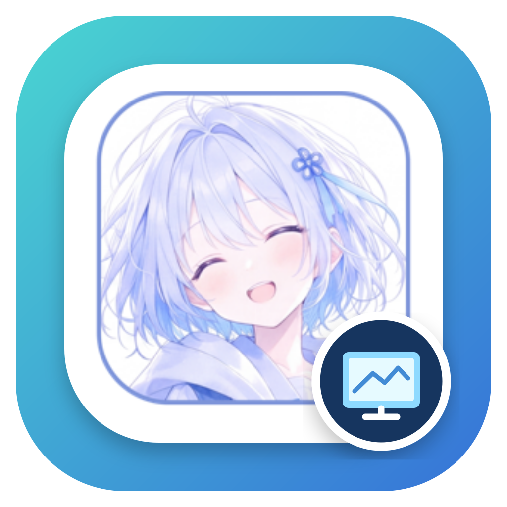

<p align="center">
  
</p>

<h1 align="center">鈴 Suzu — macOS / Windows デスクトップマスコット</h1>

<p align="center">
  <a href="README.md">English</a> | <b>日本語</b>
</p>

<p align="center">
  オリジナルキャラクター「鈴」が Mac と Windows のデスクトップで暮らすネイティブアプリ。<br>
  歩いたり、ウィンドウの上に乗ったり、うとうとしたり、クリックに反応したりします。
</p>

---

## 特徴

- **それぞれの OS のネイティブアプリ**：macOS は Swift（AppKit + Core Animation + SwiftUI）、Windows は C# / .NET 8（WinForms + Win32 のレイヤードウィンドウ）。Electron / Web 技術は不使用
- **デスクトップに常駐**：枠なし・背景透過。すべての操作スペース・フルスクリーンの上に表示
- **作業の邪魔をしない**：透明部分のクリックは後ろのアプリへ通り、鈴をクリックしてもフォーカスを奪わない
- **自律行動**：待機・散歩・見回す・振り返る・うとうと・画面の端へ行く など。
  元気度・時刻・居場所・クールダウンで確率が変わるため、完全なランダムにはならない
- **ウィンドウとの関わり**：ウィンドウの上に立つ／ウィンドウを動かすと一緒に移動／閉じると落ちる／飛び降りる
- **マウス操作**：クリックで反応、ドラッグで移動・放り投げ、ダブルクリックで会話画面、カーソルの方を向く
- **なめらかな表示**：モニターのリフレッシュレートに合わせて描画（180Hz のモニターなら 180fps）
- **自分好みに調整**：大きさ（40〜200%）・不透明度・最前面表示・動く速さ・フレームレート
- **複数ディスプレイ対応**（隣の画面へ歩いて移動）、位置の保存と復元、ログイン時の自動起動
- **軽量**：メモリ 約 50〜100MB、CPU は 60fps 以下なら 1% 前後（Apple Silicon・release ビルドでの実測。180fps では数 %）
- **鈴秘書との連携口**：ローカル AI 秘書「鈴秘書」から通知・セリフ・表情を受け取れる

## インストール

インストーラーは**このリポジトリの一番上のフォルダ**に置いてあります。お使いの OS のものをダウンロードしてください。
0.2.0 以降の最新版は [Releases](https://github.com/Lis-louis/suzu-desktop-focus/releases/latest) にあります（Windows は `SuzuSetup-<バージョン>-x64.exe`、macOS は `Suzu-<バージョン>.pkg`）。

| OS | ファイル | ダウンロード |
|---|---|---|
| macOS | [`Suzu-0.1.0.pkg`](Suzu-0.1.0.pkg) | [直接ダウンロード](https://github.com/Lis-louis/suzu-desktop-focus/raw/main/Suzu-0.1.0.pkg) |
| Windows | [`SuzuSetup-0.1.0.exe`](SuzuSetup-0.1.0.exe) | [直接ダウンロード](https://github.com/Lis-louis/suzu-desktop-focus/raw/main/SuzuSetup-0.1.0.exe) |

- **macOS**：`.pkg` を開き、案内に従ってインストールします（ようこそ → 使用許諾 → インストール）。「アプリケーション」に Suzu.app が入り、完了すると鈴が起動します。
- **Windows**：`.exe` を実行し、セットアップウィザードの案内に従います（使用許諾 → インストール先 → デスクトップアイコン・サインイン時の起動 → インストール）。自分のユーザー用にインストールするので、管理者権限は不要です。

アンインストール：macOS は鈴を終了して「アプリケーション」の Suzu をゴミ箱へ。Windows は **設定 → アプリ → インストールされているアプリ → 鈴 Suzu → アンインストール**。

> インストーラーはまだコード署名していないため、初回に OS の警告が出ることがあります。
> macOS：.pkg が開けないときは **システム設定 → プライバシーとセキュリティ** で「このまま開く」をクリック。
> Windows：SmartScreen が出たときは **詳細情報 → 実行** をクリック。

### 自動アップデート（Windows 版 0.2.0 以降・macOS 版 0.3.0 以降）

起動してから 10 秒後と、その後 3 時間ごとに新しいバージョンがないか確認し、裏でダウンロードします（設定 → **アプリ** の「アップデートを確認」で今すぐ確認することもできます）。設定はそのまま引き継がれます。

- **Windows**：準備ができると通知が出て、コントロールパネルと通知領域のメニューに **再起動して更新** が出ます。押すと画面なしで入れ替わって鈴が起動し直します。押さずにアプリを終了しても、終了するときに入れ替わります
- **macOS**：準備ができると鈴が吹き出しで知らせ、コントロールパネルとメニューバーのメニューに **アップデートをインストール** が出ます。押すとインストーラーが開くので、案内に従ってください（管理者のパスワードが必要です）。インストールが終わると鈴が起動し直します

自動アップデートのない古い版（Windows 版 0.1.0・macOS 版 0.2.0 以前）を使っている場合は、一度だけ手動で新しいインストーラーを入れ直してください。

## 動作環境

- macOS 14 Sonoma 以降（Apple Silicon・Intel）
- Windows 10（バージョン 1809 以降）/ Windows 11 の 64 ビット版（x64。Arm 版でもエミュレーションで動作）
- ビルドする場合：Xcode 16 以降 / Swift 6 ツールチェーン（macOS）、.NET 8 SDK（Windows）

## 使い方

| 操作 | 内容 |
|---|---|
| 鈴をクリック | 反応する（眠っていたら起きる） |
| 鈴をドラッグ | 好きな場所へ移動。勢いよく離すと放り投げる |
| 鈴をダブルクリック | 会話画面を開く |
| 鈴を右クリック | メニュー（止める・呼ぶ・一時停止・大きさ・最前面表示・会話・設定） |
| 鈴の上で ⌘（macOS）／Ctrl（Windows）を押しながらスクロール | 大きさを変える |
| Dock のアイコン（macOS）／通知領域のアイコン（Windows）をクリック | コントロールパネルを開く |
| メニューバーの鈴のアイコン（macOS）／通知領域のアイコンを右クリック（Windows） | 右クリックと同じメニュー |
| Dock のアイコンを右クリック（macOS） | 鈴を止める／起動する・呼ぶ・コントロールパネル |
| ⌘Q（macOS）／メニューの「終了」（Windows） | アプリを終了 |

Windows では、タスクバー右端の通知領域に鈴のアイコンが出ます。見当たらないときは **^**（隠れているインジケーターを表示）をクリックしてください。

### コントロールパネル

- **鈴を止める／起動する**：アプリは動かしたまま、鈴だけを消す・出す（停止中は CPU をほぼ使わない）
- **呼ぶ**：マウスのある画面に鈴を呼び寄せる
- **話す**・**設定**：会話画面・設定画面を開く
- **大きさ**：スライダーと −／＋ ボタンで調整
- **自律行動を一時停止**：その場でじっとさせる
- **ログイン時に起動**（Windows は「サインイン時に起動」）：自動で起動する（macOS では `/Applications` に置いて使うのがおすすめ）

### 設定

| 項目 | 内容 | 既定 |
|---|---|---|
| 表示言語 | 日本語／English | 日本語（Windows は OS の言語に合わせる） |
| 大きさ | 40〜200%（5% きざみ） | 100% |
| 不透明度 | 30〜100% | 100% |
| ほかのウィンドウより手前に表示 | オフにすると、ほかのウィンドウの後ろに隠れることがある | オン |
| フレームレート | 「モニターに合わせる」か、上限 30〜240fps。「いまの表示」で実際の fps を確認できる | モニターに合わせる |
| ウィンドウの上に乗る・飛び降りる | ウィンドウを足場にするか | オン |
| 自律行動を一時停止 | その場でじっとさせる | オフ |
| 動く速さ | ×0.5〜×2.0 | ×1.0 |
| 素材が揃うまでの暫定設定 | 下記参照 | オフ |

**「見た目と行動の設定を初期値に戻す」** で、言語と起動の設定以外を既定に戻せます。

大きさは、右クリックメニューの **「大きさ」** からも選べます（50%・75%・100%・125%・150%・200%、1 段階ずつ大きく・小さく）。
フレームレートは高いほど動きがなめらかになりますが、電力を少し多く使います。ノートパソコンでバッテリーを長持ちさせたいときは 60fps などに下げてください。

## ビルドと起動

### macOS

```sh
git clone https://github.com/Lis-louis/suzu-desktop-focus.git
cd suzu-desktop-focus

scripts/build_app.sh          # build/Suzu.app を作成
open build/Suzu.app           # 起動
```

開発中は次のコマンドも使えます。

```sh
swift run Suzu                # .app を作らずに起動
swift test                    # 単体テスト
```

### Windows

[.NET 8 SDK](https://dotnet.microsoft.com/download/dotnet/8.0) が必要です。リポジトリ直下の PowerShell で：

```powershell
dotnet test windows\Suzu.Core.Tests        # 単体テスト
dotnet run --project windows\Suzu          # 起動
```

### インストーラーの作成

| インストーラー | コマンド | できるもの |
|---|---|---|
| macOS `.pkg` | `scripts/build_pkg.sh`（Mac で） | `build/Suzu-<バージョン>.pkg`（Apple Silicon・Intel 両対応） |
| Windows セットアップ `.exe` | `powershell -ExecutionPolicy Bypass -File windows\build.ps1`（Windows で。[Inno Setup 6](https://jrsoftware.org/isdl.php) が必要） | `build\windows\SuzuSetup-<バージョン>.exe` |

Windows の `.exe` は Mac では作れません（逆も同じ）。それぞれの OS で作ってください。

バージョン番号は `VERSION` ファイルで管理しています。

GitHub に push すると、[Installers](.github/workflows/installers.yml) ワークフローが GitHub の macOS・Windows マシンで両方のインストーラーを作り、Artifacts に置きます（ビルドの確認用）。

**新しい版を配布するとき**は、`VERSION` を上げて（例：`0.2.0` → `0.3.0`）main に push してください。ワークフローがテスト → 両方のインストーラーの作成 →
[Releases](https://github.com/Lis-louis/suzu-desktop-focus/releases) にタグ `v<バージョン>` で公開まで行い、インストール済みの鈴が自動でアップデートします。
`VERSION` を上げていない push では Release は作りません。途中で失敗したときは Actions →「Installers」→ **Run workflow** で、足りないファイルを上げ直して公開します。
一番上のフォルダのインストーラー（0.1.0）は自動では更新されません。

macOS のパッケージを署名・公証する場合は `APP_SIGN_IDENTITY`・`PKG_SIGN_IDENTITY`・`NOTARY_PROFILE` を設定してください（`scripts/build_pkg.sh` の先頭のコメント参照）。

## プロジェクト構成

```
Suzu-0.1.0.pkg    macOS 用インストーラー
SuzuSetup-0.1.0.exe Windows 用インストーラー
Sources/          macOS 版（Swift）
├─ SuzuCore/      行動・物理・地形・スプライト解決（AppKit 非依存・テスト対象）
├─ SuzuBridge/    鈴秘書との連携インターフェース
└─ SuzuApp/       画面表示・マウス操作・コントロールパネル・設定・会話画面
windows/          Windows 版（C# / .NET 8）
├─ Suzu.Core/     SuzuCore と連携 JSON の移植（Windows API 非依存）
├─ Suzu.Core.Tests/ macOS 版と同じ内容の単体テスト
├─ Suzu/          透過ウィンドウ・通知領域アイコン・コントロールパネル・設定・会話画面
├─ installer/     セットアップウィザード（Inno Setup のスクリプトと画像）
└─ build.ps1      テスト → Suzu.exe → セットアップウィザードの作成
packaging/macos/  macOS 用インストーラー（.pkg）の画面とスクリプト
Resources/
├─ Sprites/       鈴の画像（PNG）と manifest.json
└─ AppIcon/       アプリアイコン
Tests/            単体テスト
docs/
├─ DESIGN.md      設計書（デザイン分析・技術選定・実現可能性・アーキテクチャ）
└─ ASSETS.md      アニメーション素材の一覧と不足素材
tools/            素材の切り出し・アイコンやインストーラー画像の作成・連携テスト用ツール
scripts/          .app / .pkg のビルドスクリプト
```

詳しくは [docs/DESIGN.md](docs/DESIGN.md) を参照してください。

## キャラクターデザインと画像素材

鈴のデザイン基準は `suzu photo/` にある 2 枚の設定資料です。
**衣装・髪型・髪飾り・配色は資料から変更しない**ことをルールにしています。

現在の画像は設定資料から切り出した 3 ポーズ（正面・右向き・背面）のみです。
足りない素材（左向き、歩行コマ、座る、眠る、落下 など）は [docs/ASSETS.md](docs/ASSETS.md) にまとめています。
画像を `Resources/Sprites/` に置いて `manifest.json` に 1 行足すと、その素材を使う行動が自動で使えるようになります。

### 素材が揃うまでの暫定設定

- **左向きに右向き画像を反転して使う（仮）**：鈴の髪飾りは左側だけにあるため、反転するとデザインが変わる。既定はオフ
- **素材が未完成の行動も試す**：座る・眠る・登る などを、立ち姿＋吹き出しで代用して動作確認する

## 鈴秘書との連携

`SecretaryBridge` プロトコルを通してやり取りします。現在はローカルの `DistributedNotificationCenter` を使った最小実装です。
Windows 版は、同じユーザーのプロセスからだけ接続できる名前付きパイプ（`\\.\pipe\jp.suzu.secretary.event`、1 行に 1 イベントの JSON）を使います。JSON の形式は同じです。

```sh
# 鈴秘書の代わりにセリフを送る
swift tools/send_event.swift '{"type":"speak","text":"おつかれさま！"}'                  # macOS
powershell -File tools\send_event.ps1 '{"type":"speak","text":"おつかれさま！"}'        # Windows
```

| type | 例 | 動作 |
|---|---|---|
| `speak` | `{"type":"speak","text":"…"}` | 吹き出しで話す・会話画面に表示 |
| `notify` | `{"type":"notify","title":"…","body":"…"}` | 驚いて通知を表示 |
| `expression` | `{"type":"expression","pose":"joy","duration":3}` | 表情・反応 |
| `activity` | `{"type":"activity","hint":"userFocused"}` | 集中中・会議中は静かにする |

## 開発状況

| 段階 | 状態 |
|---|---|
| 設計・素材の洗い出し | 完了 |
| 透過常駐・ドラッグ・コントロールパネル | 完了 |
| 基本アニメーション・デスクトップ移動 | 完了（今ある素材の範囲で） |
| ウィンドウの上に乗る・追従・飛び降りる | 完了 |
| ぶら下がる・登る | 仕組みは完成、素材待ち |
| 座る・眠る・歩行アニメーション | 素材待ち |
| 鈴秘書との本格連携 | 鈴秘書側の実装に合わせて対応予定 |

### 既知の制限

- 左向きの素材がないため、左へ歩くときは正面の立ち姿のまま移動する
- 「ほかのウィンドウより手前に表示」をオフにしても、ウィンドウの裏に回り込む動きはしない（ほかのウィンドウに隠れるだけ）
- ウィンドウを鈴が動かす機能はない（他のアプリを操作する権限が必要になるため）
- Windows：最大化したウィンドウと「常に手前に表示」のウィンドウは足場にしない。設定は `%APPDATA%\Suzu\settings.json` に保存

## 権限について

ウィンドウの位置の取得に、画面収録やアクセシビリティの許可は必要ありません。
取得するのはウィンドウの位置と大きさだけで、ウィンドウの名前や中身は読み取りません。

## ライセンス

このリポジトリは、プログラムとキャラクターでライセンスが分かれています。

| 対象 | ライセンス |
|---|---|
| プログラム（`Sources/`、`Tests/`、`windows/`、`packaging/`、`scripts/`、`tools/` など） | [MIT License](LICENSE) |
| キャラクター「鈴」（名前・デザイン・画像・アイコン・設定資料） | [キャラクター利用ガイドライン](CHARACTER_GUIDELINES.md) |

鈴のファンアートは、クレジット表記をすれば非営利で自由に描いて公開できます。
次のことは禁止しています。

- 公序良俗に反する使用
- 無断転載・再配布
- 商用利用
- AI の学習への利用

改造版のアプリを配布するときは、鈴の画像と名前をすべて削除してください（公式の鈴ではなくなるため）。

```
キャラクター「鈴」© Lis-louis
```
