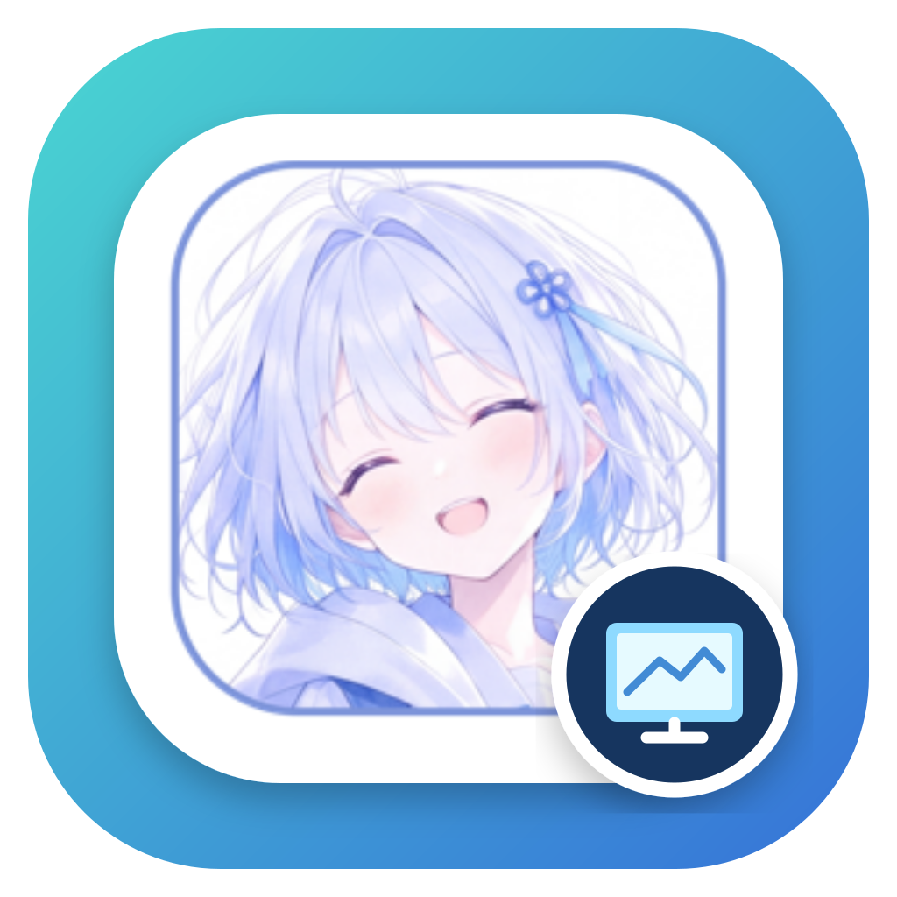

<p align="center">
  
</p>

<h1 align="center">Suzu 鈴 — a desktop mascot for macOS and Windows</h1>

<p align="center">
  <b>English</b> | <a href="README.ja.md">日本語</a>
</p>

<p align="center">
  A native app for macOS and Windows where the original character Suzu lives on your desktop.<br>
  She walks around, stands on top of your windows, dozes off, and reacts when you click her.
</p>

---

## Features

- **Native on each OS**: macOS uses Swift (AppKit + Core Animation + SwiftUI); Windows uses C# / .NET 8 (WinForms + Win32 layered windows). No Electron or web technologies.
- **Lives on your desktop**: borderless and transparent. Shown on every Space and over full-screen apps.
- **Stays out of your way**: clicks on transparent areas pass through to the app behind, and clicking Suzu never steals focus from the app you are using.
- **Acts on her own**: idling, walking, looking around, turning away, dozing, heading to the screen edge, and more.
  Her choices depend on her energy, the time of day, where she is, and cooldowns, so her behavior isn't purely random.
- **Interacts with windows**: hops up onto windows from the floor (0.5.3 and later), stands on top of windows, moves along when a window moves, falls when it closes, and jumps down.
- **Mouse interaction**: click to get a reaction, drag to move or throw her, double-click to open the chat window. She turns toward your cursor.
- **Ball play** (Windows 0.5.0 and later, Mac 0.5.3 and later): Suzu chases a ball and kicks it around. She sometimes brings one out on her own, and you can bring one out with "Ball" in the menu or Control Panel. Drag the ball to throw it, or click it to make it bounce.
- **Smooth motion**: draws in step with your monitor's refresh rate (180 fps on a 180 Hz monitor).
- **Make her your own**: size (40–200%), opacity, keep-on-top, movement speed, and frame rate.
- **Multiple displays** (she walks over to the next screen), saved and restored position, and launch at login.
- **Lightweight**: about 50–100 MB of memory and around 1% CPU at 60 fps or below (measured on Apple Silicon, release build; a few percent at 180 fps).
- **Hooks for Suzu Secretary**: receives notifications, lines, and expressions from the local AI assistant "Suzu Secretary" (鈴秘書).

## Install

The installers are in **the top folder of this repository**. Download the one for your OS.
Version 0.2.0 and later are on [Releases](https://github.com/Lis-louis/suzu-desktop-focus/releases/latest) (`SuzuSetup-<version>-x64.exe` for Windows, `Suzu-<version>.pkg` for macOS).

| OS | File | Download |
|---|---|---|
| macOS | [`Suzu-0.1.0.pkg`](Suzu-0.1.0.pkg) | [Direct download](https://github.com/Lis-louis/suzu-desktop-focus/raw/main/Suzu-0.1.0.pkg) |
| Windows | [`SuzuSetup-0.1.0.exe`](SuzuSetup-0.1.0.exe) | [Direct download](https://github.com/Lis-louis/suzu-desktop-focus/raw/main/SuzuSetup-0.1.0.exe) |

- **macOS**: open the `.pkg` and follow the installer (Welcome → License → Install). Suzu.app goes into Applications and starts when the installer finishes.
- **Windows**: run the `.exe` and follow the setup wizard (License → Install location → Desktop icon / start at sign-in, on by default → Install). It installs for the current user, so no administrator rights are needed.

To uninstall: on macOS, quit Suzu and move it from Applications to the Trash. On Windows, use **Settings → Apps → Installed apps → 鈴 Suzu → Uninstall**.

> The installers are not code-signed yet, so the OS may warn you the first time.
> macOS: if the .pkg is blocked, go to **System Settings → Privacy & Security** and click **Open Anyway**.
> Windows: if SmartScreen appears, click **More info → Run anyway**.

### Automatic updates (Windows 0.2.0+, macOS 0.3.0+)

Suzu checks for a new version 10 seconds after it starts and every 3 hours after that, and downloads it in the background (you can also check right away with **Check for updates** under Settings → **App**). Your settings are kept.

- **Windows** (0.4.0 and later): when the update is ready, Suzu counts down from 10 seconds, then the update is installed and Suzu restarts automatically. While it installs, Suzu stays where she was with an "Updating…" bubble (0.5.1 and later). If you turn off **Install new versions automatically** under Settings → **App**, the update is installed only when you click **Restart to update** in the Control Panel or the tray menu (or when you quit the app)
- **macOS**: when the update is ready, Suzu tells you in a speech bubble and **Install Update** shows up in the Control Panel and the menu bar menu. Click it to open the installer and follow the steps (an administrator password is needed). Suzu restarts when the installation finishes

If you are on a version without automatic updates (Windows 0.1.0, macOS 0.2.0 or earlier), install the new version manually once.

## Requirements

- macOS 14 Sonoma or later (Apple Silicon or Intel)
- Windows 10 (version 1809 or later) / Windows 11, 64-bit (x64. Also runs on Arm through emulation)
- To build: Xcode 16 or later / Swift 6 toolchain (macOS), .NET 8 SDK (Windows)

## Usage

| Action | Result |
|---|---|
| Click Suzu | She reacts (and wakes up if she was sleeping) |
| Drag Suzu | Move her anywhere. Release with momentum to throw her |
| Double-click Suzu | Open the chat window |
| Right-click Suzu | Menu (stop, call, play with a ball, pause, size, keep on top, chat, settings) |
| Drag the ball | Throw it. Suzu runs after it and starts playing |
| Click the ball | The ball bounces |
| Scroll over Suzu while holding ⌘ (macOS) / Ctrl (Windows) | Resize her |
| Click the Dock icon (macOS) / the tray icon (Windows) | Open the control panel |
| Click the bell in the menu bar (macOS) / right-click the tray icon (Windows) | Same menu as right-clicking Suzu |
| Right-click the Dock icon (macOS) | Stop/start Suzu, call her, open the control panel |
| ⌘Q (macOS) / "Quit" in the menu (Windows) | Quit the app |

On Windows, Suzu's icon sits in the notification area (system tray) at the right end of the taskbar. If you don't see it, click **^** to show hidden icons.

### Control panel

- **Stop / Start Suzu**: hides or shows Suzu while the app keeps running (almost no CPU while stopped).
- **Call**: brings Suzu to the screen your mouse is on.
- **Chat** / **Settings**: open the chat window or the settings.
- **Size**: adjust with the slider or the − / + buttons.
- **Pause autonomous behavior**: keeps her still where she is.
- **Launch at login** (on Windows, "Launch when you sign in"): starts automatically (on macOS, works best with the app in `/Applications`).

### Settings

| Setting | What it does | Default |
|---|---|---|
| Display language | Japanese / English | Japanese (Windows follows the OS language) |
| Size | 40–200%, in 5% steps | 100% |
| Opacity | 30–100% | 100% |
| Keep above other windows | When off, other windows can cover her | On |
| Frame rate | "Match monitor" or a cap from 30 to 240 fps. "Currently" shows the real fps | Match monitor |
| Climb onto and jump off windows | Whether she uses windows as footholds | On |
| Play with a ball | Whether she plays with the ball (and sometimes brings one out on her own) | On |
| Pause autonomous behavior | Keeps her still | Off |
| Movement speed | ×0.5–×2.0 | ×1.0 |
| Temporary options until the assets are ready | See below | Off |

**Reset appearance and behavior to defaults** restores everything except the language and startup options.

You can also pick a size from **Size** in the right-click menu (50%, 75%, 100%, 125%, 150%, 200%, or one step larger/smaller).
A higher frame rate looks smoother but uses a little more power. On a laptop, lower it to 60 fps or so to save battery.

> The app is shown in Japanese by default. You can switch it to English in Settings → Language.

## Build and run

### macOS

```sh
git clone https://github.com/Lis-louis/suzu-desktop-focus.git
cd suzu-desktop-focus

scripts/build_app.sh          # creates build/Suzu.app
open build/Suzu.app           # run it
```

During development you can also use:

```sh
swift run Suzu                # run without creating the .app
swift test                    # unit tests
```

### Windows

Requires the [.NET 8 SDK](https://dotnet.microsoft.com/download/dotnet/8.0). In PowerShell at the repository root:

```powershell
dotnet test windows\Suzu.Core.Tests        # unit tests
dotnet run --project windows\Suzu          # run it
```

### Building the installers

| Installer | Command | Output |
|---|---|---|
| macOS `.pkg` | `scripts/build_pkg.sh` (on a Mac) | `build/Suzu-<version>.pkg` (Apple Silicon and Intel) |
| Windows setup `.exe` | `powershell -ExecutionPolicy Bypass -File windows\build.ps1` (on Windows; requires [Inno Setup 6](https://jrsoftware.org/isdl.php)) | `build\windows\SuzuSetup-<version>.exe` |

The Windows `.exe` can't be built on a Mac (and vice versa), so build each one on its own OS.

The version number comes from the `VERSION` file.

Pushing to GitHub runs the [Installers](.github/workflows/installers.yml) workflow, which builds both installers on GitHub's macOS and Windows machines and uploads them as Artifacts (useful as a build check).

**When you release a new version**, bump `VERSION` (for example `0.2.0` → `0.3.0`) and push to main. The workflow tests, builds both installers, and publishes them to
[Releases](https://github.com/Lis-louis/suzu-desktop-focus/releases) under the tag `v<version>`; installed copies of Suzu then update themselves.
Pushes that don't bump `VERSION` don't create a release. If a run fails partway, use Actions → "Installers" → **Run workflow** to upload the missing files and publish.
The installers in the top folder (0.1.0) are not updated automatically.

To sign and notarize the macOS package, set `APP_SIGN_IDENTITY`, `PKG_SIGN_IDENTITY`, and `NOTARY_PROFILE` (see the comments in `scripts/build_pkg.sh`).

## Project structure

```
Suzu-0.1.0.pkg    macOS installer
SuzuSetup-0.1.0.exe Windows installer
Sources/          macOS version (Swift)
├─ SuzuCore/      behavior, physics, terrain, sprite resolution (no AppKit, unit-tested)
├─ SuzuBridge/    interface to Suzu Secretary
└─ SuzuApp/       rendering, mouse input, control panel, settings, chat window
windows/          Windows version (C# / .NET 8)
├─ Suzu.Core/     port of SuzuCore and the bridge's JSON format (no Windows APIs)
├─ Suzu.Core.Tests/ the same unit tests as the macOS version
├─ Suzu/          layered windows, tray icon, control panel, settings, chat window
├─ installer/     setup wizard (Inno Setup script and images)
└─ build.ps1      tests → Suzu.exe → setup wizard
packaging/macos/  macOS installer (.pkg) screens and scripts
Resources/
├─ Sprites/       Suzu's images (PNG) and manifest.json
└─ AppIcon/       app icon
Tests/            unit tests
docs/
├─ DESIGN.md      design document (design analysis, technology choices, feasibility, architecture)
└─ ASSETS.md      animation assets and the list of missing ones
tools/            tools for cutting out sprites, making icons and installer images, and testing the bridge
scripts/          .app / .pkg build scripts
```

See [docs/DESIGN.md](docs/DESIGN.md) for details (in Japanese).

## Character design and image assets

Suzu's design reference is the two character sheets in `suzu photo/`.
The rule is **never to change her outfit, hairstyle, hair ornament, or colors** from those sheets.

For now, the only images are three poses cut out from the sheets (front, facing right, back).
Missing assets (facing left, walk frames, sitting, sleeping, falling, and so on) are listed in [docs/ASSETS.md](docs/ASSETS.md).
Put a PNG in `Resources/Sprites/` and add one line to `manifest.json`, and the behaviors that need it are enabled automatically.

### Temporary options until the assets are ready

- **Mirror the right-facing image for the left (temporary)**: Suzu's hair ornament is only on her left side, so mirroring changes her design. Off by default.
- **Try behaviors with unfinished assets**: shows sitting, sleeping, climbing, and so on with the standing pose plus a speech bubble, for testing.

## Suzu Secretary integration

All communication goes through the `SecretaryBridge` protocol. The current implementation is a minimal one using the local `DistributedNotificationCenter`.
The Windows version uses named pipes that only the same user's processes can connect to (`\\.\pipe\jp.suzu.secretary.event`, one JSON event per line). The JSON format is the same.

```sh
# Send a line to Suzu in place of Suzu Secretary
swift tools/send_event.swift '{"type":"speak","text":"Good work today!"}'                       # macOS
powershell -File tools\send_event.ps1 '{"type":"speak","text":"Good work today!"}'             # Windows
```

| type | Example | Result |
|---|---|---|
| `speak` | `{"type":"speak","text":"…"}` | Says it in a speech bubble and shows it in the chat window |
| `notify` | `{"type":"notify","title":"…","body":"…"}` | Looks surprised and shows the notification |
| `expression` | `{"type":"expression","pose":"joy","duration":3}` | Expression / reaction |
| `activity` | `{"type":"activity","hint":"userFocused"}` | Stays quiet while you focus or are in a meeting |

## Status

| Stage | Status |
|---|---|
| Design and asset inventory | Done |
| Transparent overlay, dragging, control panel | Done |
| Basic animation and moving around the desktop | Done (within the current assets) |
| Standing on, following, and jumping off windows | Done |
| Hanging and climbing | Logic done, waiting for assets |
| Sitting, sleeping, walk animation | Waiting for assets |
| Full Suzu Secretary integration | Planned, to match Suzu Secretary's implementation |

### Known limitations

- There is no left-facing image yet, so when walking left she uses the mirrored right-facing image (0.5.3 and later; the hair ornament appears on the other side). When standing and facing left, she is mirrored only if "Mirror the right-facing image for the left" is turned on.
- Even with "Keep above other windows" turned off, she doesn't walk behind windows on purpose; other windows simply cover her.
- Suzu cannot move other windows (that would need permission to control other apps).
- Windows: maximized windows and always-on-top windows are not used as footholds. Settings are stored in `%APPDATA%\Suzu\settings.json`.

## Permissions

Reading window positions needs no Screen Recording or Accessibility permission.
The app reads only each window's position and size, never its title or contents.

## License

Code and character are licensed separately.

| What | License |
|---|---|
| Code (`Sources/`, `Tests/`, `windows/`, `packaging/`, `scripts/`, `tools/`, etc.) | [MIT License](LICENSE) |
| The character Suzu (name, design, images, icon, character sheets) | [Character Usage Guidelines](CHARACTER_GUIDELINES.en.md) |

You may draw and share non-commercial fan art of Suzu, with credit.
The following are not allowed:

- Uses that go against public decency
- Reposting or redistributing the images
- Commercial use
- Using Suzu for AI training

If you distribute a modified version of the app, remove all of Suzu's images and her name (it is no longer the official Suzu).

```
Character "Suzu" © Lis-louis
```
